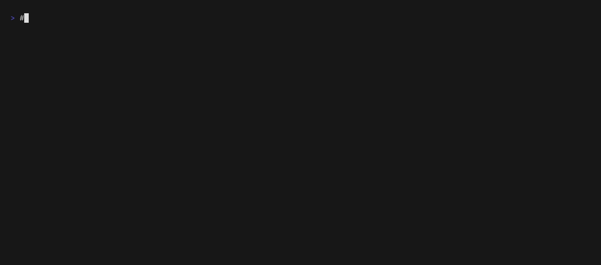

<!-- SPDX-License-Identifier: Apache-2.0 -->
# The quickstart, recorded

[`sayfirst.gif`](sayfirst.gif) and [`sayfirst.webm`](sayfirst.webm) are one
run of a selection of the command line's
[`QUICKSTART.md`](https://github.com/fredaime/sayfirst-cli/blob/v0.3.3/QUICKSTART.md)
against sayfirst 0.3.3 as it is published on the package index. Every command
shown was typed into a real shell, and what follows it is what that command
printed. Hidden lines only create the three-line program and clear the screen
between scenes.



## What it shows, in order

1. `uv tool install` puts the client, the daemon and the daemon's operator
   surface into one environment, every distribution at 0.3.3.
2. `sayfirst-daemon up --quickstart` writes a starter policy, starts the
   daemon, and prints its answer to a status request, grade line included:
   `observability`, because in per-user mode the caller can write the store it
   is asking about.
3. A three-line program that starts a process runs under the client's
   `instrument run` verb with `--pack subprocess`: the policy allows it, and
   it prints `hello`.
4. One word of the policy changes, `"allow"` becoming `"deny"`, and nothing is
   restarted. The same run ends with exit `1` and `Denied`; the process was
   never started.
5. `"deny"` becomes `"suspend"`: exit `5`, `Suspended`, and an approval to
   answer. The client's `approvals approve` answers it, and the next run is the
   one execution that person's act authorised.
6. The client's `evidence export` writes the chain the daemon kept to a bundle
   that can be checked offline. The daemon's epoch is still open, so coverage
   is `unknown` and the command exits `7`, « could not check », rather than
   claiming more.
7. `sayfirst-daemon down` stops the daemon, and the same run ends with exit `4`
   and `CouldNotAsk`. No control plane answered, so the effect did not happen,
   and that is not called a denial.

## Where it departs from the quickstart

- **It is a selection.** It leaves out `sayfirstd status`, the history and
  `approvals show` of sections 3 and 4, `instrument verify` of section 5,
  `ask` of sections 6 and 7, and section 7's `explain`, `trace` and
  closed-epoch exports. It exports before `down`, where the quickstart exports
  after the second `up`.
- **The install is pinned.** `==0.3.3` on each distribution, split over two
  lines with `\`, so that a later render records the same release.
- **The program file is written by a hidden line**, with the three lines the
  quickstart prints and `cat` then shows.
- **A refusal's traceback goes to a file.** A refusal is an exception raised
  inside the governed program, and its traceback is long. The recording sends
  the program's error stream to `err.txt`, shows its last line, which names the
  outcome, and shows the exit status with `echo "exit $?"`.
- **The policy is edited with `sed`**, the same one-word change the quickstart
  makes by hand, and the approval reference is read out of `err.txt` with
  `grep` instead of being pasted.

What the recording does not show is said where the project describes itself:
sayfirst is not a sandbox — a program that does not call the boundary is not
governed, so pair it with operating-system sandboxing for code you do not
trust — and the grade the daemon reports is `observability`, at which no claim
of proof or of tamper detection is made. The [README](../../README.md) and
[`SECURITY.md`](../../SECURITY.md) state both.

## How it is made

| File | What it is |
|---|---|
| [`sayfirst.tape`](sayfirst.tape) | The script [vhs](https://github.com/charmbracelet/vhs) types into the shell, with the hidden lines named above. |
| [`Dockerfile`](Dockerfile) | The machine it runs on: the vhs renderer and uv, both pinned by digest, Python 3.12 as `python3`, and an account named `demo` with an empty home directory. |
| [`render.sh`](render.sh) | Builds that image, runs the tape in it, checks the transcript, stamps both recordings with their licence identifier, and writes them here. |

```console
$ docs/demo/render.sh
```

It needs Docker, Python 3, GNU `tar` and `stat`, and network access to the
container registries, to the Python downloads uv uses when the image is built,
and to the package index. It takes about two minutes. The tape installs
sayfirst from the index inside the container, so neither a checkout nor
anything installed on the machine that renders reaches the recording.

`render.sh` keeps a recording only when the run was the one the tape types: the
text transcript vhs writes beside the video must show, in this order, the three
distributions installed at 0.3.3, the daemon ready at grade `observability`, the
allowed run, exit `1` with `Denied`, exit `5` with `Suspended`, the approval
`approved`, the authorised run, the bundle saved with its chain `intact` and
coverage `unknown` and exit `7`, the daemon stopped, and exit `4` with
`CouldNotAsk`. It also refuses a GIF of 2 MB or more. Either way it writes
nothing, and the files here stay as they were; when it does write, each file is
renamed into place whole.

Identifiers, timestamps and hashes differ from one render to the next; the
outcomes do not.
